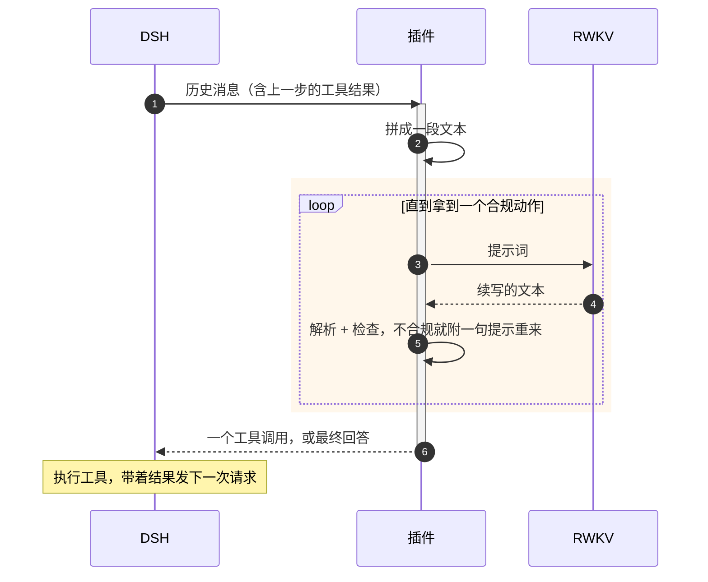
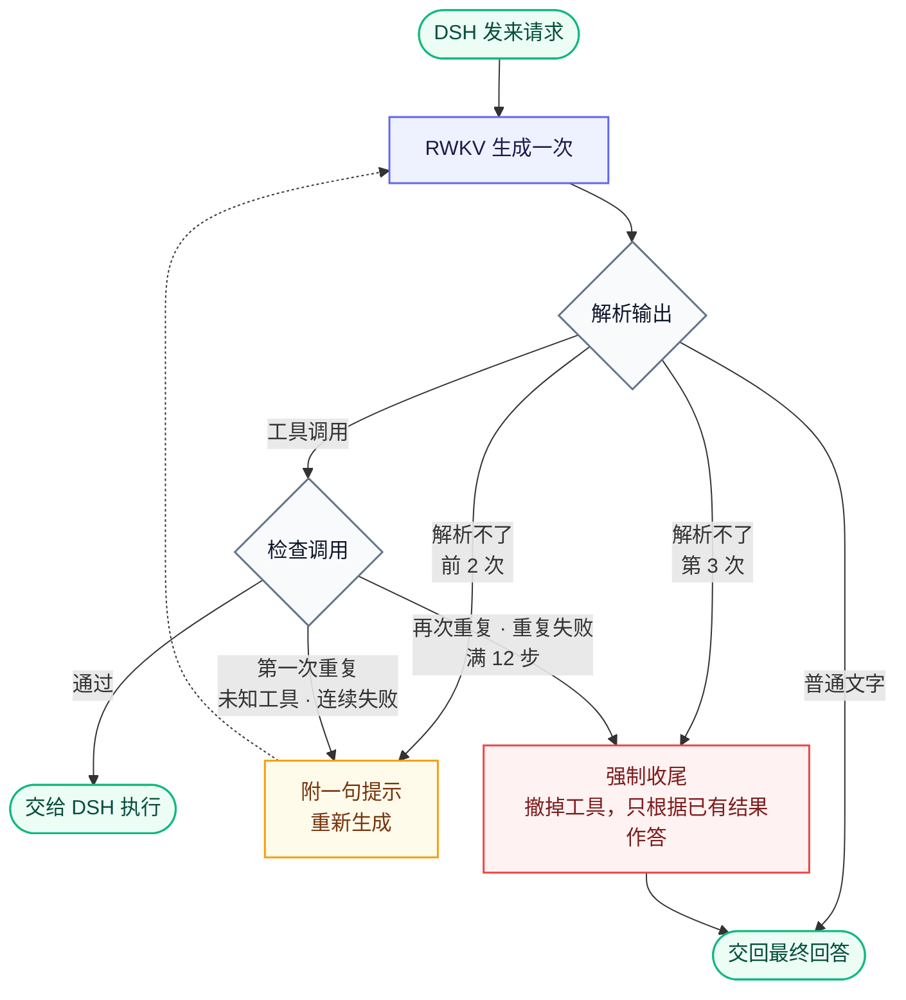

# dsh-rwkv-plugin

把 RWKV-7 G1 Agent 接进 [DeepSeek Harness](https://github.com/deepseek-ai/deepseek-harness)（下称 DSH）：注册一个 `rwkv` 模型提供方，RWKV 可以当主 Agent，也可以作为子 Agent 给 DeepSeek 主 Agent 调用。

**安装见 [INSTALL.md](INSTALL.md)。** 每个环节的细节（提示词裁了哪几段、每种兜底的触发条件、怎么排查）见 [docs/how-it-works.md](docs/how-it-works.md)。

## 一张图看懂

DeepSeek 这类模型走对话接口：DSH 把系统提示词和工具 schema 发过去，模型在接口的工具调用字段里回一个调用。RWKV 只会**续写文本**，所以插件夹在中间当翻译：



- DSH 照常管会话、执行工具、管沙箱和审批，它不知道背后是 RWKV。
- 一次 DSH 请求在插件里可能对应好几次 RWKV 生成（重问、续写），这些过程 DSH 看不到，记在插件自己的轨迹里。
- 工具执行完，DSH 带着新的结果发下一次请求，插件从 DSH 的记录**重新拼一遍**提示词。插件自己不存状态。

## 一次请求里发生了什么



“强制收尾”还有几层保底：再要求一次、捞出模型写过的正文、实在没有就由插件写一段不编事实的总结。各个数字（12 步、重问 2 次等）都能在设置页调。

## RWKV 实际看到什么

一次决策时 RWKV 收到的是一整段文本，下面是删减后的骨架（`←` 后面是说明，不在提示词里；完整例子见 [docs/examples](docs/examples/)）：

```text
System: You are an AI agent powered by DeepSeek Harness.   ← DSH Standard 提示词：21 段只留讲这 8 个工具的 11 段
Use the read tool — not shell commands like cat — …
Choose one action:                                          ← 动作协议：要工具就输出一个 <tool_call>，否则直接回答
- If new tool evidence is needed, output exactly one tool call and nothing else:
  <tool_call>{"name":"TOOL_NAME","arguments":{...}}</tool_call>
…
<tools>[                                                    ← 工具清单，一个工具一行，参数压成一行说明
{"name":"read","description":"Read a UTF-8 text file …","arguments":{"file_path":"…","offset":"optional number",…}},
…
]</tools>
Current date: 2026-11-07 (Asia/Shanghai, UTC+08:00).      ← 日期和时区（设置里可关）；System 块合计约 1300 token

User: 统计 data.csv 里每个城市的平均温度，结果写到 summary.md

User: Current working directory: "/home/user/project".     ← DSH 运行时上下文只留工作目录、沙箱策略两段
Current DSH file policy: workspace-write. …

Assistant: <think></think><tool_call>{"name":"read","arguments":{"file_path":"…/data.csv"}}</tool_call>   ← 历史步骤的思考留空

User: <tool_response>{"ok":true,"tool":"read","result":"…"}</tool_response>

User: Use the Tool results above to continue the current task.   ← 每条成功结果后的提醒，只在当前轮
If the evidence is sufficient, answer now. …

Assistant: <think                                           ← 模型从这里往下写
```

训练管线直接 import 本插件拼提示词的代码，所以除了日期行（训练数据里没有；评测入口 headless 默认关掉它），这套格式和训练数据逐字节一致。**改任何会进提示词的东西，都要重新生成训练数据。**

## 主要功能

| 功能 | 说明 |
|---|---|
| **后端** | rwkv_lightning CUDA（支持 adapter / state）和 iRWKV 的续写接口 |
| **工具** | bash、read、write、edit、glob、grep、web_search、web_fetch，名字和参数都用 DSH 原样；模型写训练时的旧名字（read_file、path…）会自动认回来 |
| **解析容错** | 先说话再调用、OpenAI 外壳、多余括号、字符串化参数等十来种写法 |
| **检查与收尾** | 重复调用拦截（改过文件后重读、重跑测试不算重复）、连续失败封禁、强制收尾、复读截断 |
| **设置页** | 设置 →「RWKV Agent」：管理模型、上传 adapter、调参数、开关兜底；保存后下一次请求就生效 |
| **轨迹** | 每次生成的提示词原文和模型原始输出都记下来，对话视图的「RWKV」标签页能逐条看；默认存在 DSH 会话目录里 |
| **测模型本身** | 两个开关（「修正模型输出」「插件修复」）可以关掉全部兜底，看模型原样能做到什么 |

## 已知限制

- **一步只调一个工具**，不能像原生模型那样并行发多个。
- **没有上下文压缩**，长会话迟早撑满窗口（默认报给 DSH 32768 token）。
- **只认文字**，图片、文件附件换成占位符。
- **DSH 界面上看到的比 RWKV 实际收到的多**：DSH 全局注册的工具、提示词段和运行时上下文，预设管不住，插件只能在拼 RWKV 提示词时自己过滤。所以会话「轨迹」页显示的是过滤前的内容，要看 RWKV 实际收到什么，请看「RWKV」标签页。
