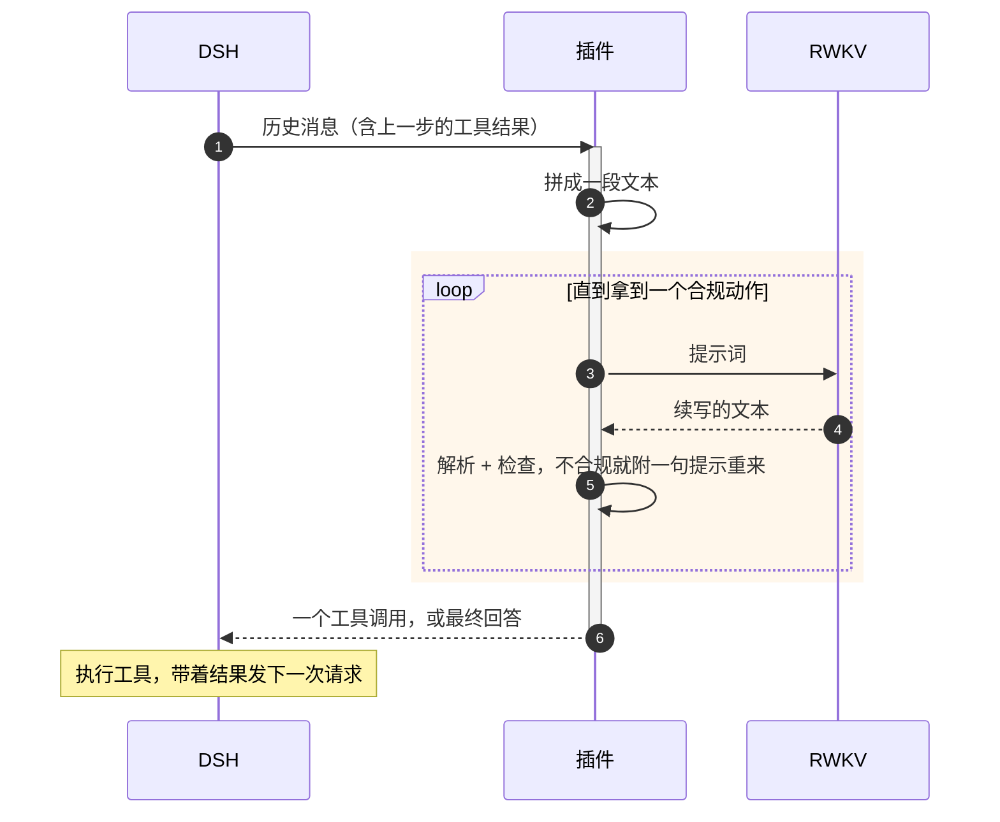

# dsh-rwkv-plugin

把 RWKV-7 G1 接进 [DeepSeek Harness](https://github.com/deepseek-ai/deepseek-harness)（下称 DSH）。

- 注册一个 `rwkv` 模型提供方：RWKV 当主 Agent，或作为子 Agent 给 DeepSeek 主 Agent 调用。
- RWKV 只会续写文本，插件负责在「对话接口」和「一整段文本」之间来回翻译。
- 会话、工具、沙箱、审批仍归 DSH 管；插件不存状态。

## 安装

需要 DSH 桌面版 **0.2.1 或更新版本**（从源码跑、开发插件见 [INSTALL.md](INSTALL.md)）。

1. **装插件**：侧栏**插件 → 添加插件**，填下面这行，点**安装**，再选**立即启用**。

   ```
   github:No-22-Github/dsh-rwkv-plugin
   ```

2. **加模型**：**设置 → RWKV Agent → 添加模型**，选后端（`rwkv_lightning CUDA` 或 iRWKV）、填服务地址和上游模型 ID 就行；lightning 还可以挂一个 adapter（可选，服务器上已有或自己上传）。保存后立即生效。
3. **开始用**：当主 Agent 就新开会话、模型选它、预设选「RWKV Agent」；当子 Agent 就保持 DeepSeek 主 Agent，会多一个 `rwkv_agent` 工具，默认用你加的第一个模型。

编辑默认走行号版 `edit_lines`（按 read 显示的行号改，不用抄原文），原生 `edit` 自动隐藏；要做 A/B 用 `--native-edit`。更新插件就是重新填一次同样的地址再装一遍。

## 一张图



- 一次 DSH 请求在插件里可能对应好几次 RWKV 生成（重问、续写），这些过程 DSH 看不到，记在插件自己的轨迹里。
- 工具执行完，DSH 带着结果发下一次请求，插件从 DSH 的记录**重新拼一遍**提示词。

## 一次决策

1. 拼提示词 → RWKV 生成。
2. 解析输出：普通文字就是最终回答；`<tool_call>` 检查后交给 DSH 执行。
3. 解析不了 → 附一句提示重来（最多 2 次）；重复调用、未知工具、连续失败 → 拦下并回一句提示。
4. 重问用完、重复第二次、满 15 步 → **强制收尾**：撤掉工具，只根据已有结果作答。

“强制收尾”还有几层保底：再要一次、捞出模型写过的正文、实在没有就由插件写一段不编事实的总结。这些数字都能在设置页调。

## RWKV 看到的提示词

<details>
<summary>展开看骨架（删减版，`←` 是说明，不在提示词里）</summary>

```text
System: You are an AI agent powered by DeepSeek Harness.   ← DSH Standard 提示词：21 段只留讲这 8 个工具的 11 段
Use the read tool — not shell commands like cat — …
Choose one action:                                          ← 动作协议：要工具就输出一个 <tool_call>，否则直接回答
- If new tool evidence is needed, output exactly one tool call and nothing else:
  <tool_call>{"name":"TOOL_NAME","arguments":{...}}</tool_call>
…
<tools>[                                                    ← 工具清单，一个工具一行，参数压成一行说明
{"name":"read","description":"Read a UTF-8 text file …","arguments":{"file_path":"…","offset":"optional number",…}},
…
]</tools>
Current date: 2026-11-07 (Asia/Shanghai, UTC+08:00).      ← 日期和时区（设置里可关）；System 块合计约 1300 token

User: 统计 data.csv 里每个城市的平均温度，结果写到 summary.md

User: Current working directory: "/home/user/project".     ← DSH 运行时上下文只留工作目录、沙箱策略两段
Current DSH file policy: workspace-write. …

Assistant: <think></think><tool_call>{"name":"read","arguments":{"file_path":"…/data.csv"}}</tool_call>   ← 历史步骤的思考留空

User: <tool_response>{"ok":true,"tool":"read","result":"…"}</tool_response>

User: Use the Tool results above to continue the current task.   ← 每条成功结果后的提醒，只在当前轮
If the evidence is sufficient, answer now. …

Assistant: <think                                           ← 模型从这里往下写
```

</details>

- 训练管线 import 的就是这份拼提示词的代码，除了日期行（headless 默认关），和训练数据逐字节一致。
- **改任何会进提示词的东西，都要重新生成训练数据。**

## 主要功能

| 功能 | 说明 |
|---|---|
| 后端 | rwkv_lightning CUDA（请求级 adapter 可选、支持上传初始 state）、iRWKV 续写接口 |
| 工具 | bash、read、write、edit_lines、glob、grep、web_search、web_fetch，名字参数照 DSH 原样；训练时的旧名字（read_file…）自动认回 |
| 解析容错 | 先说话再调用、OpenAI 外壳、多余括号、字符串化参数等十来种写法 |
| 检查与收尾 | 重复调用拦截、连续失败封禁、强制收尾、复读截断 |
| 设置页 | 模型、state、参数、兜底开关，保存即生效 |
| 轨迹 | 每次生成的提示词和原始输出，对话视图的「RWKV」标签页可查 |
| 测模型本身 | 两个开关关掉全部兜底，看模型原样能做到什么 |

## 已知限制

- 一步只调一个工具，不能并行。
- 没有 DSH 的上下文压缩，长会话迟早撑满窗口（默认报 32768 token）；RWKV 这边用接力卡片管上下文。
- 只认文字，图片和附件换成占位符。
- DSH 界面显示的内容比 RWKV 实际收到的多；要看实际收到什么，用「RWKV」标签页。

## 更多

- [docs/how-it-works.md](docs/how-it-works.md)：拼提示词的每一处裁剪、每种兜底的触发条件、怎么排查。
- [docs/examples](docs/examples)：完整的提示词例子。
- [INSTALL.md](INSTALL.md)：从源码跑、开发插件。

## 致谢

这个插件建立在下面这些项目之上，也借鉴了它们的协议和实现：

- **[DeepSeek Harness](https://github.com/deepseek-ai/deepseek-harness)**（MIT）：会话、工具、沙箱、插件机制和设置页框架，动作协议也按它的 Standard 提示词改。
- **[RWKV](https://github.com/BlinkDL/RWKV-LM)**（Apache-2.0）：RWKV-7 G1 模型本体。续写式 prompt、思考块、工具调用格式和兜底链移植自 [RWKV-Agent](https://github.com/No-22-Github/RWKV-Agent)。
- **[rwkv-tokenizer](https://github.com/cahya-wirawan/rwkv-tokenizer)**（MIT OR Apache-2.0）：`vendor/` 里内置的 WASM 分词器，用来精确计算 token 数。
- **[rwkv-tokenizer-go](https://github.com/No-22-Github/rwkv-tokenizer-go)**（Apache-2.0）：训练包和跑分的 token 口径，内置分词器和它逐条对过。

本项目以 [MIT](LICENSE) 发布，Copyright (c) 2026 No-22-Github。
