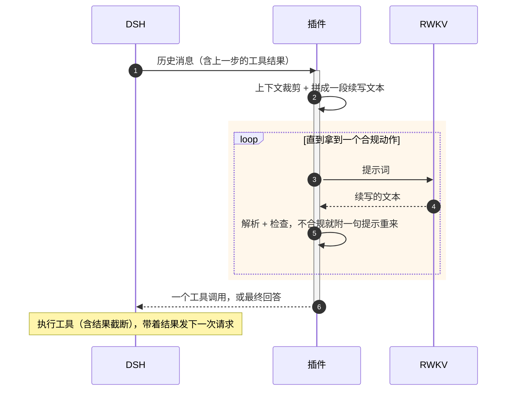

# 工作原理与架构总览

> **TL;DR（分层速读）**
> - 本插件在 DSH 对话接口与 RWKV 续写接口之间做双向翻译，一次 DSH 请求可能对应多次 RWKV 生成（重问、续写）。
> - 代码分为纯核心层 `src/core/`（无宿主/Node 强绑定，供训练管线直接复用）与宿主层 `src/`（DSH 适配器、后端、UI 与编辑工具）。
> - 详细实现按专题拆分为三篇子文档：[提示词与兜底](wire-and-prompt.md)、[编辑模式](edit-modes.md)、[上下文管理](context-modes.md)。

## 整体数据流

- 每次工具执行完，DSH 带着新结果发起下一次请求，插件都会从 DSH 会话记录**重新拼装**完整提示词，并由上下文模块决定如何折叠历史。
- 一次 DSH 请求内部的多次重问与修复过程对 DSH 不可见，完整记录在插件的 `rwkv-trace.jsonl` 中。

## 原生接入 vs 本插件

| 维度 | 原生接入（DeepSeek 等） | RWKV（本插件） |
|---|---|---|
| 系统提示词 | Standard 全文 21 段 | 裁剪为 11 段 + 动作协议 + 8 个工具清单（约 1331 token） |
| 运行时上下文 | 5 段 | 仅保留工作目录、沙箱策略 2 段（约 64 token） |
| 工具并发 | 支持并行多个 | 单步仅调 1 个工具 |
| 输出格式与纠错 | 接口保证 | 插件解析、容错修复、格式重问与强制收尾 |
| 上下文压缩 | DSH 内置压缩 | 不走 DSH 压缩；默认 `auto-fold v2`，可选 `worklist` / `relay` / `full` |
| 图片、文件附件 | 原生支持 | 替换为 `[image]` / `[file]` 占位符 |
| 采样与停止符 | DSH 控制 | 插件管停止符；采样默认 `agent-fast`，DSH 仅覆盖温度 |
| Token 计数 | 接口返回 | 后端未返回时用 vendored `rwkv-tokenizer` WASM 精确计数 |

## 目录分层：`src/core/` vs `src/`

插件采用「纯逻辑核心 + DSH 宿主适配」两层解耦，确保训练管线 `rwkv-agent-pipeline`、headless 评测与 DSH 桌面端看到**逐字节一致**的提示词与工具契约：

- **`src/core/`（纯核心层）**：不依赖 DSH 运行时与重型宿主状态，供浏览器设置页、headless 脚本与训练管线直接 import。
  - 提示词与协议：`dsh-prompt.ts`、`prompt.ts`、`tools.ts`、`defaults.ts`、`time-zone.ts`
  - 决策循环与解析：`agent.ts`、`parse.ts`、`policy.ts`、`step-gates.ts`、`tool-mappings.ts`、`tool-repairs.ts`
  - 上下文折叠：`worklist.ts`、`fold-pairs.ts`、`fold-window.ts`、`todo-state.ts`、`relay.ts`
  - 编辑纯逻辑：`src/core/edit-modes/`（`tolerant.ts`、`hashline.ts`、`line-edit.ts`、`literal.ts`、`shared.ts`）及 `tolerant-edit.ts`、`hashline.ts`、`line-edit.ts`
- **`src/`（宿主、后端与 UI 层）**：
  - 宿主接入：`index.ts`、`dsh-host.ts`、`adapter.ts`、`history.ts`、`session-setup.ts`、`routes.ts`、`paths.ts`、`result-budget.ts`、`tokenizer.ts`、`relay-store.ts`、`traces.ts`、`trace-stats.ts`
  - 后端调用：`src/backend/`（`generator.ts`、`lightning.ts`、`irwkv.ts`、`stream.ts`）
  - 宿主编辑工具：`src/edit-modes/`（含 `mode-state.ts`、`observations.ts`、`syntax-check.ts`、`folded-read-guard.ts`）及根导出 `hashline.ts` / `line-edit.ts` / `todo.ts`
  - 前端面板：`src/client/`（设置页、`TraceView.tsx`「RWKV」标签页、模型/Adapter/State 选择器）

## 核心设计原则

1. **三边一致铁律**：训练管线直接复用 `src/core/` 拼提示词；修改任何模型可见内容（提示词、工具清单、策略文案），必须同步重采训练数据与切换评测 commit。
2. **计数不跨请求**：重复调用重试、格式重问、拦截计数均只活在单次 DSH 请求内，下一轮从历史重新推算。
3. **视图隔离与可排查**：DSH 界面显示的是修复后的调用与全文提示词，与 RWKV 实际收到的文本不同。排查请看对话视图的**「RWKV」标签页**或 `~/.dsh/sessions/<工作区>/<会话id>/rwkv-trace.jsonl`（详见[提示词与兜底](wire-and-prompt.md#排查与轨迹导出)）。

## 专题文档

- **[wire-and-prompt.md](wire-and-prompt.md)**：RWKV 字节级提示词格式、`Assistant:` 无空格铁律、停止符、`agent-fast` 采样、`recover-preamble` 与容错解析、兜底开关与轨迹排查。
- **[edit-modes.md](edit-modes.md)**：4 种编辑模式（`tolerant` / `hashline` / `line-edit` / `literal`）、`src/core/edit-modes/` 与 `src/edit-modes/` 解耦、行哈希校验与增量语法闸门。
- **[context-modes.md](context-modes.md)**：`auto-fold v2`（默认）、`relay`、`worklist`、`full` 上下文管理、`3000` tok 结果截断与 `folded-read-guard` 防盲改机制。
